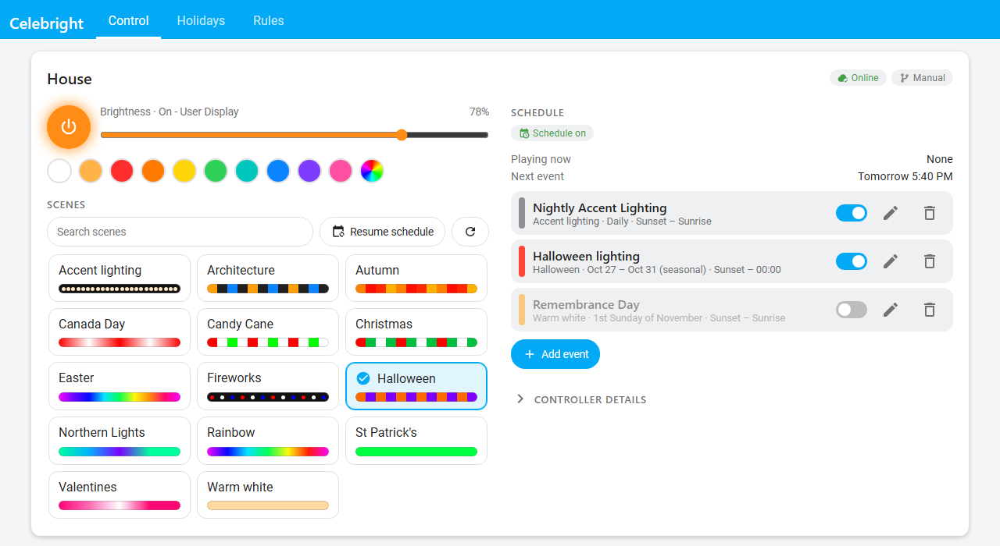
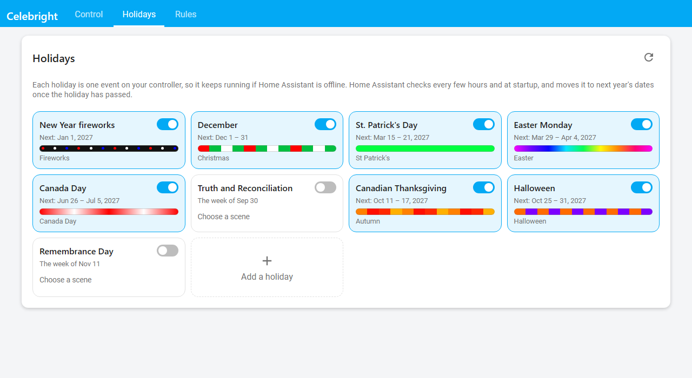
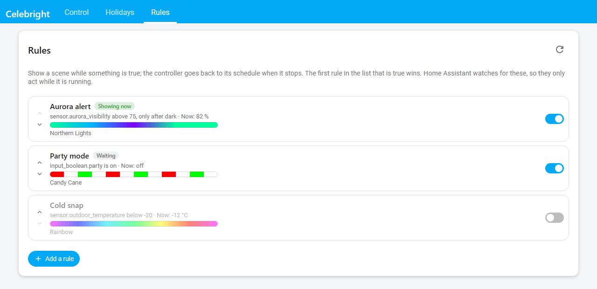
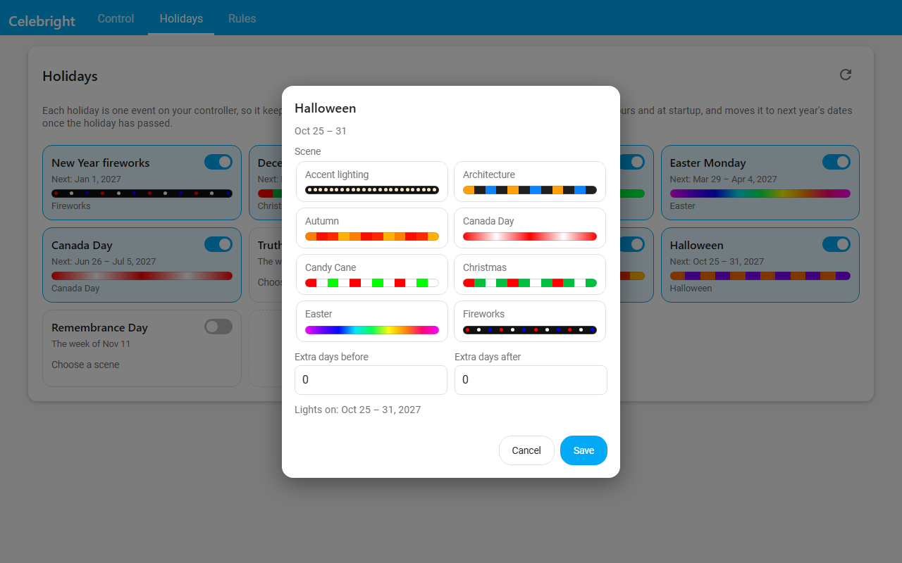
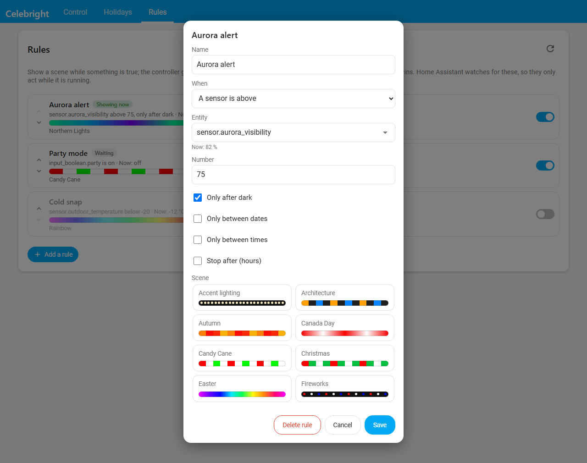
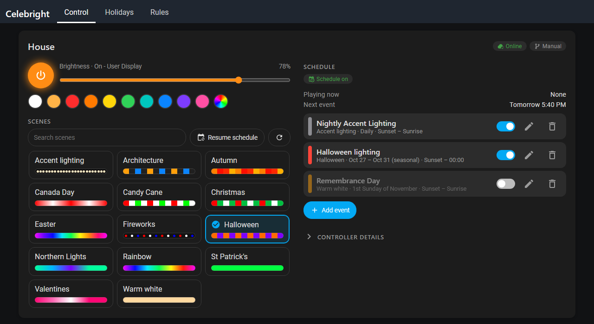
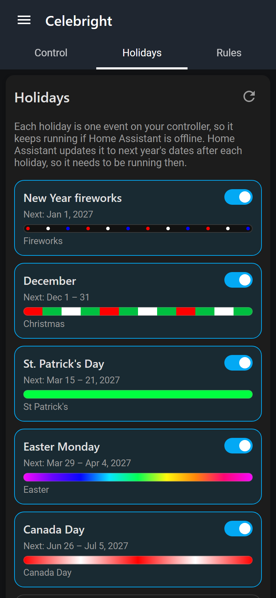

# Celebright for Home Assistant

A custom [Home Assistant](https://www.home-assistant.io/) integration for **Celebright** permanent / architectural LED lighting (CLC-series controllers). Control your lights, pick saved scenes (with colour previews), manage the built-in schedule and your holidays, react to things like the aurora, and automate it all from Home Assistant, with a graphical page of its own in the sidebar.

> **Status:** `0.4.0`, cloud-based. Tested against the `app.celebright.ca` backend and a CLC-03 controller.


<!-- ha-marketplace:exclude-start -->
[](https://my.home-assistant.io/redirect/marketplace_repository/?owner=MrToast99&repository=Celebright_ha&category=integration)
[](https://my.home-assistant.io/redirect/hacs_repository/?owner=MrToast99&repository=Celebright_ha&category=integration)
<!-- ha-marketplace:exclude-end -->

Like the work? Help keep me Caffeinated!
[](https://www.buymeacoffee.com/mrtoast99)

---

## Screenshots

*Sample data. Everything below is on the Celebright page that appears in Home Assistant's sidebar, and also available as cards for your own dashboards.*



| Holidays | Rules |
|---|---|
|  |  |
| One tile per holiday. Each becomes a single event on your controller; Home Assistant updates it to next year's dates. | The aurora alert, a switch, a sensor: a scene while it is true, then back to the schedule. |
|  |  |
| Choose the scene from a visual list and widen the window by a few days. | The **Aurora alert** starter finds your sensor and presets 75 and "only after dark". |
|  |  |
| Light and dark themes follow your Home Assistant theme. | A layout built for phones, with the sidebar's menu button. |

---

## Contents

- [Screenshots](#screenshots)
- [Features](#features)
- [How it works](#how-it-works)
- [Requirements](#requirements)
- [Installation](#installation)
  - [Marketplace (Home Assistant 2026.11 and newer)](#marketplace-home-assistant-202611-and-newer)
  - [HACS (Home Assistant 2026.10 and older)](#hacs-home-assistant-202610-and-older)
  - [Manual](#manual)
  - [Upgrading from 0.3.3?](#upgrading-from-033)
- [Configuration](#configuration)
- [Entities](#entities)
- [Sidebar page](#sidebar-page)
- [Holidays](#holidays)
- [Rules](#rules)
- [Dashboard](#dashboard)
  - [Optional extras](#optional-extras)
- [The Celebright card](#the-celebright-card)
- [Automations](#automations)
  - [Manual automations (YAML)](#manual-automations-yaml)
- [Examples](#examples)
- [The schedule](#the-schedule)
  - [Create an event](#create-an-event)
  - [Update, delete, enable/disable](#update-delete-enabledisable)
- [Troubleshooting](#troubleshooting)
- [Limitations](#limitations)
- [Contributing](#contributing)
- [Disclaimer](#disclaimer)

---

## Features

**Control and status**

| Capability | Where | Notes |
|---|---|---|
| On / off, solid colour, brightness | `light.*` and the card | RGB picker, 0-255 |
| Scene selection | `select.*`, `scene.*` and the card | Your saved scenes (a dropdown, and one scene entity each), plus **Off** to resume the schedule |
| Current display, active event, next event | `sensor.*` | Live |
| Schedule on/off | `switch.*`, `binary_sensor.*` | The switch is firmware 2.x only |
| Schedule events | `sensor.*`, services, the card | Count and decoded list; create, edit, delete and enable/disable |
| Device info | `sensor.*` | Model, firmware, hardware, LED count, bulb type, colour order, location |

**The Celebright page and cards** (see [Screenshots](#screenshots))

| Feature | What it does |
|---|---|
| **Sidebar page** | A Celebright item in Home Assistant's sidebar with three tabs: Control, Holidays, Rules. On for new installs, one toggle in the options |
| **Control** | Power, brightness, colours, scene tiles with **colour previews**, Resume schedule, and a schedule editor with a form to add, edit, delete and switch events |
| **Holidays** | A tile per holiday (New Year, December, St. Patrick's, Easter Monday, Canada Day, Truth and Reconciliation, Thanksgiving, Halloween, Remembrance Day, and your own). Each is one event on the controller, updated to next year's dates by this integration (in Home Assistant), so moving holidays and windows around a date work reliably |
| **Rules** | Show a scene while something is true (aurora above a level, a switch, a sensor), with limits (after dark, dates, times, stop after N hours), a priority list and an **Aurora alert** starter |
| Automations card | For dashboards of your own: your blueprint automations in one place (switch, run, edit), with a warning if two holiday controllers compete. Not part of the sidebar page |
| Themes and phones | Light and dark, two columns on a wide screen, bottom-sheet editors on a phone |

**Automation tools**

| Feature | What it does |
|---|---|
| Blueprints | Holiday lighting controller (superseded by Holidays and Rules), scene in a date range, scene for a holiday week, scene on a toggle, resume the schedule at a time, controller-offline notification |
| Services | `celebright.create_event`, `update_event`, `delete_event`, `set_event_enabled`, `refresh_scenes`, `generate_dashboard` |
| Generated dashboard | A ready-made dashboard with your device filled in: three full-width views (Control, Holidays, Rules) |

---

## How it works

Celebright has no local API; everything goes through its AWS cloud:

```
Home Assistant
  ├─ Login ...... AWS Cognito (SRP; your password is never sent) → tokens + temporary AWS credentials
  ├─ Status ..... REST (devices, scenes, schedule) + AppSync GraphQL (live state), polled every 30 s
  └─ Control .... AWS IoT MQTT over WebSocket
```

Newer controllers (firmware 3.x) use a newer MQTT protocol ("v3"); older ones use "v2". The integration detects which one each controller speaks. It is `cloud_polling` and needs an internet connection.

**What runs where.** It matters when something goes offline:

| Feature | Runs on | If Home Assistant is offline |
|---|---|---|
| Schedule events you create | The controller | Keeps running |
| **Holidays** | The controller (one event per holiday) | Keeps running; Home Assistant only rolls the dates to next year when it is running |
| **Rules** (aurora, switch, sensor) | Home Assistant | Not acting, as the sensors live in Home Assistant |
| Blueprint automations and your own automations | Home Assistant | Not acting |

---

## Requirements

- Home Assistant **2024.10** or newer (the Marketplace in 2026.11+, or HACS before)
- A Celebright account (the email and password you use in the Celebright app)
- A controller that is online and registered to that account

---

<!-- ha-marketplace:exclude-start -->
## Installation

### Marketplace (Home Assistant 2026.11 and newer)

HACS is now built into Home Assistant as the **Marketplace**.

1. **Settings → Marketplace**, then **Add from link** (upper right).
2. Enter `MrToast99/Celebright_ha` and add it (the Marketplace asks you to connect GitHub the first time, which it needs to add a repository by link). Or click the **Install with Marketplace** badge at the top.
3. Open **Celebright** in the list and **Install**, then **restart Home Assistant** (a repair offers a Restart button).

Updates arrive under **Settings → Updates**, with these release notes. Repositories added by link are checked every 48 hours.

### HACS (Home Assistant 2026.10 and older)

(Or click the **Install with HACS** badge at the top, which opens HACS on your Home Assistant.)

1. **HACS → Integrations → ⋮ → Custom repositories**.
2. Add `https://github.com/MrToast99/Celebright_ha` with category **Integration**.
3. Find **Celebright**, click **Download**, then **restart Home Assistant**.

If you update Home Assistant to 2026.11 or newer, the Marketplace takes over from HACS by itself: Celebright stays installed and keeps getting updates, and nothing needs redoing.

### Manual

Copy `custom_components/celebright` into your config folder (`<config>/custom_components/celebright/`; `<config>` is `/config` on Home Assistant OS / Container) and restart Home Assistant.

### Upgrading from 0.3.3?

Read the **migration guide** at the top of the [changelog](CHANGELOG.md). It is short: update, restart, refresh the browser.
<!-- ha-marketplace:exclude-end -->

---

## Configuration

1. **Settings → Devices & Services → + Add Integration → Celebright**.

   [](https://my.home-assistant.io/redirect/config_flow_start/?domain=celebright)

2. Enter your Celebright email and password.

One Home Assistant **device** is created per controller. Credentials are stored in Home Assistant's config entry store and sent only to Celebright/AWS endpoints, as the official app does. If the password later stops working, Home Assistant shows a **Re-authenticate** prompt.

---

## Entities

For a controller named **House**:

| Entity ID | Purpose |
|---|---|
| `light.house` | On/off, RGB colour, brightness |
| `select.house_scene` | Pick a saved scene, or **Off** (resume the schedule). Follows the controller's real scene, also when you change it in the Celebright app |
| `scene.house_<scene name>` | One per saved scene: activate it from automations, scripts, dashboards or voice. Listed on a separate "Scenes" sub-device, not the main device page. Appears and disappears as you add and delete scenes in the app |
| `sensor.house_current_display` | Active scene, or "Off" |
| `sensor.house_active_event` | Scheduled event playing now (`None` if none; `None` also while a manual scene is showing) |
| `sensor.house_next_event_start` | When the next event starts (the controller's local time; unknown while a manual scene is showing) |
| `sensor.house_active_source` | What drives the lights: `off`, `user_display`, `event`, ... (diagnostic) |
| `switch.house_schedule_enabled` | Turn the built-in schedule on / off (firmware 2.x only) |
| `binary_sensor.house_schedule` | Schedule on: the controller's flag, or "has scheduled events" on newer firmware |
| `sensor.house_scheduled_events` | Event count; the decoded list is in the attributes (`events`) |
| `sensor.house_model`, `_firmware`, `_hardware_version`, `_led_count`, `_bulb_type`, `_color_order`, `_location` | Device info (diagnostic) |
| `button.house_refresh_scenes` | Re-pull scenes and schedule from your account (config) |

Replace `house` with your device's slug if it is named differently (see **Settings → Devices & Services → Entities**).

**Holidays and rules are not entities or services** (yet). You set them on the Celebright page or cards. A holiday that is playing shows up as the active event: `sensor.house_active_event` reads `Holiday: Halloween`, so you can trigger automations on it.

**What Celebright stores in Home Assistant:** your holiday and rule settings, in `.storage/celebright_holidays` and `.storage/celebright_rules` of your config folder (included in Home Assistant backups). Removing the integration leaves them; delete the files to start over.

---

## Sidebar page

New installs get a **Celebright** item in Home Assistant's sidebar, with nothing to set up. It has three tabs: **Control** (the card: power, colour, scenes, schedule), **Holidays** and **Rules**. With several controllers it has a picker, and it remembers the tab and controller you used last.

- **Turn it off or on:** **Settings → Devices & services → Celebright → Configure** → **Show Celebright in the sidebar**. No restart needed.
- **Upgrading?** Installs from before 0.4.0 keep it off; switch it on the same way.
- The page is open to every user, like a dashboard. Only administrators can change things (holidays, rules, events); other users can look.

## Holidays

The sidebar page's **Holidays** tab (also `custom:celebright-holidays-card`) is a graphical way to light your holidays: a tile for each of New Year fireworks, December, St. Patrick's Day, Easter Monday, Canada Day, Truth and Reconciliation, Canadian Thanksgiving, Halloween and Remembrance Day. Pick a scene (with its colour preview), switch the tile on, and optionally add or remove days before and after. **Add a holiday** makes your own, from any start to end date (it may cross New Year).

**How it works.** Each holiday is **one ordinary event on your controller**, named `Holiday: <name>`, that covers the *next* occurrence: nightly from sunset to midnight, from the first night to the last. When that window has passed, **this integration, running in your Home Assistant (not Celebright's cloud)**, updates the same event to next year's dates. It checks every few hours. It never relies on the controller's yearly repeat rules, which can't express a moving holiday or a window that starts before the date and ends after it. Because the event lives on the controller, it keeps running if Home Assistant, your internet or Celebright's cloud is down; Home Assistant only has to be running at some point after each holiday to roll the dates forward. If it is off for the whole stretch until the next holiday, the event simply stays on the old dates and doesn't play until Home Assistant is back and has updated it.

- **Week holidays** cover the Monday-Sunday week that contains the date (so Canadian Thanksgiving, the 2nd Monday of October, and Easter Monday follow the calendar by themselves). Halloween is Oct 25-31, December is the whole month, and New Year fireworks is midnight to 00:15 on Jan 1.
- **Extra days** (up to 14 either way) widen the window, or narrow it with a negative number.
- You'll also see the events in the Celebright app. Edit holidays in Home Assistant, not the app: the next sync restores the Home Assistant settings. Celebright only ever changes or deletes events it created (those named `Holiday: ...`); your own events are never touched.
- **Don't run these together with the holiday lighting blueprint.** If that automation is on, the tab warns you and offers to turn it off. If you used it for the aurora alert, recreate that on the **Rules** tab.
- Switch a holiday off and its event is deleted. Anyone can see the tab; only administrators can change it.
- Up to 12 of your own holidays. A holiday whose scene is deleted in the app shows an error on its tile; pick another scene.
- It is built to work on firmware 2.x too (the event repeats daily until the last night), but that hasn't been tried on that hardware.

## Rules

The sidebar page's **Rules** tab (also `custom:celebright-rules-card`) shows a scene **while something is true**, then hands the controller back to its schedule. It is for things only Home Assistant knows: the aurora, a switch, a temperature.

**Aurora, step by step.** Open **Rules → Aurora alert**. Celebright looks for a sensor with "aurora" in its name and fills it in, with *above 75* and *only after dark* already set; pick the scene and **Save**. That's the whole setup.

A rule is made of:
- **When:** a sensor is above or below a number, or an entity is in a state (default `on`, for a switch, toggle, presence sensor and so on).
- **Limits (optional):** only after dark; only between two dates (may cross New Year); only between two times (may cross midnight); stop after a number of hours.
- **A scene** (with its colour preview).

**Priority.** Rules are a list; the first one that is true wins. Use the arrows to reorder. When a higher rule ends while a lower one is still true, the lower one takes over without a gap.

**How it behaves**
- A rule acts when it **becomes** true (and again if the winning rule changes), not on every check, so it doesn't fight you while it stays true.
- When no rule is true any more, the controller returns to its schedule (including your `Holiday:` events), **but only if the scene the rule set is still the one showing**. A scene you picked by hand in the meantime is left alone.
- A rule that has run past its "stop after" limit stops, and starts again only after its condition has gone false and returned.
- Each rule shows its live reading, and a badge: *Showing now*, or *Waiting* (true, but a rule above it is showing, or it timed out). A failing controller is shown on the rule and retried every five minutes.
- Home Assistant runs the rules, so they act only while it is running. After a restart a rule that is already true shows its scene.
- Anyone can see the tab; only administrators can change rules. Up to 20 rules per controller.
- A rule's scene overrides the schedule and `Holiday:` events while it is showing, like picking the scene by hand.

## Dashboard

You can also put the cards on your own dashboard. The integration generates a ready-made one (the Celebright card and your automations) with **your** device and entity IDs, so there is nothing to edit.

1. **Developer Tools → Actions → `Celebright: Generate dashboard`** → run. It writes `celebright_dashboard.yaml` to your config folder (`filename` changes the name; with several controllers pass `device_id`).
2. Use it one of two ways:
   - **YAML dashboard (recommended).** Add this to `configuration.yaml`, restart, and open **Celebright** in the sidebar (the key needs a hyphen, e.g. `celebright-lights`):

     ```yaml
     lovelace:
       dashboards:
         celebright-lights:
           mode: yaml
           title: Celebright
           icon: mdi:string-lights
           show_in_sidebar: true
           filename: celebright_dashboard.yaml
     ```

   - **Storage dashboard.** **Settings → Dashboards → + Add Dashboard → New dashboard from scratch**, open it → **⋮ → Edit Dashboard → ⋮ → Raw configuration editor**, paste the file's contents, **Save**.
3. After updating the integration, run the action again, or tap **Regenerate this dashboard** under the card on the **Control** view (it needs the default file name; a YAML dashboard shows the new file on refresh). Nothing to find-and-replace.

Views: **Control** (the Celebright card, with the Regenerate button under it), **Holidays** and **Rules**, each a full-width panel. They are the same three screens as the sidebar page and read scenes, schedule and device info live from your account.

### Optional extras

**Without the Celebright card** (stock cards only, e.g. as a fallback), add a view like this; replace `house` with your device's slug (**Settings → Devices & Services → Entities**, the part before `_scene`):

```yaml
- title: Lights
  cards:
    - type: entities
      entities:
        - light.house
        - select.house_scene
        - sensor.house_current_display
        - sensor.house_next_event_start
    - type: light
      entity: light.house
    - type: markdown
      content: >
        
        - **{{ e.name }}**: {{ e.scene }}, {{ e.when }}, {{ e.time }}
        
```

---

## The Celebright card

The sidebar page is made of cards you can also place on any dashboard. They share one file, which the integration serves and registers itself.

| Card | Shows | Options |
|---|---|---|
| `custom:celebright-card` | Control, scenes, schedule and controller details | `device`, `title`, `show_controls`, `show_scenes`, `show_schedule`, `show_info` |
| `custom:celebright-holidays-card` | The Holidays tiles and editor | `device` |
| `custom:celebright-rules-card` | The rules list and editor | `device` |
| `custom:celebright-automations-card` | Your blueprint automations | `title` |

`device` is optional with one controller (the Celebright device id, or the Home Assistant device id). Add a card from the dashboard editor (**Add card → Celebright**) or in YAML, for example:

```yaml
type: custom:celebright-holidays-card
device: "123456789"
```

### The control card

**`custom:celebright-card`**: It follows your theme (light and dark) and works on a phone, where the event editor opens as a bottom sheet.

- **Controls:** power, brightness and colour (a swatch row and a colour picker).
- **Scenes:** every saved scene as a tile with a colour preview strip (solid colour, pattern palette or individual bulbs; the pattern's motion isn't drawn), the active one marked, a search box, **Resume schedule** and a refresh button. Previews come from the scenes the integration last loaded (every 30 minutes, or the refresh button); reload the page to see a scene you've just recoloured.
- **Schedule:** whether it runs, what is playing, the next event, and every event with an on/off toggle, edit and delete. **Add event** opens a form (name, scene, priority, sunset / sunrise / a time with an offset, first night, and once / every day / every year by date or by weekday). Controllers on firmware 2.x have no one-off events, offsets or per-event switch, and the form hides them.
- **Controller details:** model, firmware, hardware, LED count, bulb type, colour order and location (collapsed).

There is nothing to install: the integration serves the card and adds it to your dashboard resources itself. After updating, refresh the browser once. Add it from the dashboard editor (**Add card → Celebright**), or in YAML:

```yaml
type: custom:celebright-card
device: <device id>      # optional with one controller; pick it in the editor
title: House             # optional, defaults to the controller's name
show_controls: true      # each section can be switched off
show_scenes: true
show_schedule: true
show_info: true
```

**Layout.** On a wide card the controls and scenes sit on the left and the schedule on the right; on a phone everything stacks. Home Assistant's default (masonry) view squeezes a card into one narrow column, so for the two-column layout put it in a **panel** view (the generated dashboard's Card view already is one) or give it more columns in a sections view.

If your Lovelace resources are in YAML mode (`lovelace: mode: yaml`), Home Assistant won't let the integration add a resource, so it loads the card on every page instead. Nothing to do.

The dashboard that `celebright.generate_dashboard` writes has the card on its **Control** view. A dashboard you wrote earlier, or generated by an older version, doesn't have it, and a YAML dashboard has no card picker: run the action again, or add `type: custom:celebright-card` to a view yourself.

**The card isn't showing up?**
1. Open `/celebright_static/celebright-card.js` on your Home Assistant address. A page of JavaScript means the integration is serving it; a 404 means the integration files are still the old version (update, then restart).
2. Hard-refresh the browser (Ctrl+Shift+R), or clear the app's cache in the Companion app (**Settings → Companion app → Debugging**).
3. Check the log (**Settings → System → Logs**, search "Celebright card"). It says either that the resource was registered or that the card is loaded on every page.
4. Turn on **Advanced mode** (profile) and look under **Settings → Dashboards → ⋮ → Resources** for `/celebright_static/celebright-card.js`.

### The automations card

`custom:celebright-automations-card` (in the same file, nothing more to install) lists the automations built from the Celebright blueprints, grouped by blueprint. Each row has a switch, **Run now**, last run and **Edit**; a blueprint with none yet has a **Create** button, except the superseded ones (the holiday controller, date range, holiday week and toggle blueprints, which the Holidays and Rules tabs replace): those are listed, marked *Superseded*, only if you still have an automation from them. It warns when two copies of the holiday controller are both on, since they would fight. It is not part of the sidebar page or the generated dashboard; add it to a dashboard of your own if you want it. Home Assistant's own **Settings → Automations & Scenes** can also filter by blueprint.

Home Assistant can't open a new automation pre-filled from a blueprint, so **Create** takes you to **Settings → Blueprints**; pick the blueprint there and choose **Create automation**. Use **Edit** on an existing one rather than creating a second. The card finds each blueprint by its file name, wherever Home Assistant stored it (an import is filed under the GitHub owner's name). If it can't group them (no search integration, or a non-admin user whose blueprints aren't under `celebright/`), it lists automations with "Celebright" in the name instead. Non-admin users see the list but not Edit or Create.

### Removing the old YAML

Back up first (**File editor**, or copy the files). Home Assistant doesn't need the old files once you've switched.

**The old dashboard** (`celebright_dashboard.yaml`, added in `configuration.yaml`):
1. Open `configuration.yaml` and delete the `celebright-lights:` block (the entry under `lovelace: dashboards:` that has `filename: celebright_dashboard.yaml`). Keep other dashboards you have.
2. Delete `celebright_dashboard.yaml` from your config folder.
3. **Developer Tools → YAML → Check configuration**, then **Restart**. The Celebright sidebar page (**Configure → Show Celebright in the sidebar**) takes its place. If you'd rather keep a dashboard, run **Generate dashboard** instead of deleting.

**The old automations** (`celebright_automations.yaml`, or ones pasted into the automation editor):
1. Remove the line that includes the file (for example `automation celebright: !include celebright_automations.yaml`) from `configuration.yaml`, then delete the file. For ones you pasted into the UI, open **Settings → Automations & Scenes**, select the old Celebright ones and delete them.
2. **Developer Tools → YAML → Check configuration**, then **Reload automations**.
3. Rebuild what you need from the blueprints (**Settings → Automations & Scenes** lists them, and can filter by blueprint). **Don't run the old holiday YAML and the holiday blueprint together**: they compete and the lights flip between them.

## Automations

Automations come as **blueprints**: you pick your controller and scenes from dropdowns, with nothing to edit (needs Home Assistant 2024.10+). Click **Import**, then **Settings → Automations & Scenes → Blueprints →** the blueprint **→ Create automation**. Re-import a blueprint to get updates.

| Blueprint | What it does | |
|---|---|---|
| **Holiday lighting controller** | *Superseded by the Holidays and Rules tabs.* One automation for New Year fireworks, an optional aurora alert, Halloween (Oct 25–31), December and week-long holidays (St. Patrick's, Canada Day, Canadian Thanksgiving, Remembrance Day, Easter Monday, Truth and Reconciliation), plus four **custom holidays** of your own (any date range, even across New Year). Leave a holiday's scene empty to skip it. | [](https://my.home-assistant.io/redirect/blueprint_import/?blueprint_url=https%3A%2F%2Fgithub.com%2FMrToast99%2FCelebright_ha%2Fblob%2Fmain%2Fblueprints%2Fautomation%2Fcelebright%2Fholiday_lighting_controller.yaml) |
| **Scene at sunset during a date range** | A scene every night from sunset inside a yearly date range (may cross New Year); resumes the schedule at sunrise. | [](https://my.home-assistant.io/redirect/blueprint_import/?blueprint_url=https%3A%2F%2Fgithub.com%2FMrToast99%2FCelebright_ha%2Fblob%2Fmain%2Fblueprints%2Fautomation%2Fcelebright%2Fscene_in_date_range.yaml) |
| **Scene for a holiday week** | A scene dusk to dawn for the Monday-Sunday week containing a date, every year. | [](https://my.home-assistant.io/redirect/blueprint_import/?blueprint_url=https%3A%2F%2Fgithub.com%2FMrToast99%2FCelebright_ha%2Fblob%2Fmain%2Fblueprints%2Fautomation%2Fcelebright%2Fscene_for_holiday_week.yaml) |
| **Scene on a toggle** | *The Rules tab does this graphically.* A scene while an `input_boolean` is on; resumes the schedule when it turns off. | [](https://my.home-assistant.io/redirect/blueprint_import/?blueprint_url=https%3A%2F%2Fgithub.com%2FMrToast99%2FCelebright_ha%2Fblob%2Fmain%2Fblueprints%2Fautomation%2Fcelebright%2Fscene_toggle.yaml) |
| **Resume the schedule at a time** | Hands control back to the schedule at a set time each day. | [](https://my.home-assistant.io/redirect/blueprint_import/?blueprint_url=https%3A%2F%2Fgithub.com%2FMrToast99%2FCelebright_ha%2Fblob%2Fmain%2Fblueprints%2Fautomation%2Fcelebright%2Fresume_schedule_at_time.yaml) |
| **Controller offline notification** | Runs an action (a notification by default) when the controller has been unavailable for a while. | [](https://my.home-assistant.io/redirect/blueprint_import/?blueprint_url=https%3A%2F%2Fgithub.com%2FMrToast99%2FCelebright_ha%2Fblob%2Fmain%2Fblueprints%2Fautomation%2Fcelebright%2Fcontroller_offline_notify.yaml) |

- **Timing:** a week-long holiday runs Monday to Sunday around its date. Under **Adjust holiday timing** you can extend each by up to 14 days before or after, and move Halloween's first and last day. To shorten or move a holiday, leave its scene empty and use a custom holiday. Overlapping holidays resolve by priority: New Year, aurora, custom 1–4, Halloween, December, then the week-long ones.
- **Updating a blueprint:** re-import it (**Blueprints → ⋮ → Re-import blueprint**), which overwrites it in place, then edit your existing automation. *Create automation* always makes a new one, so use it only for the first time (or to run a blueprint for a second set of lights).
- Scenes are picked from your saved scenes (each one is a `scene.*` entity). Resuming the schedule uses the controller's scene dropdown, so pick it too.
- Use the holiday controller **instead of** the date-range / holiday-week blueprints for the same lights; they would compete.
- No import button? Paste the blueprint's GitHub URL into **Blueprints → Import Blueprint**. The files are in [`blueprints/automation/celebright`](blueprints/automation/celebright).

### Manual automations (YAML)

Prefer plain YAML to blueprints? [`celebright_automations.yaml`](celebright_automations.yaml) holds the same ideas as a list of automations: a holiday lighting controller, scene at sunset, Halloween, holiday week, party toggle, offline notification and lights off late at night. Two edits first:

- **Slug:** the entity IDs use `house` (`select.house_scene`, `light.house`) because the reference controller is named House. Find and replace `house` with your own slug: **Settings → Devices & services → Entities**, search `celebright`, and take the part between the dot and `_scene` (`select.front_yard_scene` → `front_yard`).
- **Scene names:** replace every `REPLACE WITH YOUR SCENE NAME` with a scene exactly as it appears in the scene dropdown.

Then add it one of two ways (they need different formats):

**A. Include the file (use it as-is).** Put it next to `configuration.yaml` (e.g. `/config/celebright_automations.yaml`, lowercase, ending in `.yaml`), then add this at the far left of `configuration.yaml`. If you already have an `automation:` line, add it on the next line; the word after `automation` is just a label:

```yaml
automation: !include automations.yaml            # may already exist
automation celebright: !include celebright_automations.yaml
```

Run **Developer Tools → YAML → Check Configuration**, then **Reload Automations**. `Unable to read file …` means the file isn't beside `configuration.yaml` (wrong folder, a hidden `.txt`, or a capital letter).

**B. Paste one automation into the UI.** The file is a list, so pasting all of it gives `extra keys not allowed @ data['0']`. In **Create automation → ⋮ → Edit in YAML**, paste a single automation as a plain mapping, with no leading `-` and no `id:` line:

```yaml
alias: Celebright scene at sunset
description: ""
triggers:
  - trigger: sun
    event: sunset
conditions:
  - condition: template
    value_template: "{{ now().month == 12 }}"
actions:
  - action: select.select_option
    target:
      entity_id: select.house_scene
    data:
      option: "REPLACE WITH YOUR SCENE NAME"
mode: single
```

Use the file's holiday controller **instead of** its simpler seasonal examples for the same lights; they would compete.

---

## Examples

Entity IDs assume a controller named **House**. Put these in `automations.yaml`, or paste one into **Create automation → ⋮ → Edit in YAML**.

**Show a scene at sunset** (a scene entity):

```yaml
alias: Candy Cane at sunset
triggers:
  - trigger: sun
    event: sunset
actions:
  - action: scene.turn_on
    target:
      entity_id: scene.house_candy_cane
```

**Hand control back to the schedule at sunrise** (**Off** is in quotes):

```yaml
alias: Resume the schedule at sunrise
triggers:
  - trigger: sun
    event: sunrise
actions:
  - action: select.select_option
    target:
      entity_id: select.house_scene
    data:
      option: "Off"
```

**Set a colour and brightness:**

```yaml
actions:
  - action: light.turn_on
    target:
      entity_id: light.house
    data:
      rgb_color: [255, 120, 0]
      brightness: 180
```

**Get a message when a scheduled event or a holiday starts:**

```yaml
alias: Tell me what is playing
triggers:
  - trigger: state
    entity_id: sensor.house_active_event
conditions:
  - condition: template
    value_template: "{{ trigger.to_state.state not in ['None', 'unknown', 'unavailable'] }}"
actions:
  - action: notify.notify
    data:
      message: "Now playing: {{ trigger.to_state.state }}"   # e.g. "Holiday: Halloween"
```

**Say when the lights come on next** (a template; the time is the controller's local time):

```yaml
{{ as_timestamp(states('sensor.house_next_event_start')) | timestamp_custom('%A at %-I:%M %p') }}
```

**Pause an event while you are away** (firmware 3.x):

```yaml
actions:
  - action: celebright.set_event_enabled
    data:
      event_name: "Nightly Accent Lighting"
      enabled: false
```

**Switch the whole schedule off** (firmware 2.x):

```yaml
actions:
  - action: switch.turn_off
    target:
      entity_id: switch.house_schedule_enabled
```

For "show a scene while something is true" (aurora, a switch, a temperature) use the **Rules** tab instead of writing an automation. For holidays use the **Holidays** tab.

---

## The schedule

The schedule runs on the controller itself. The integration shows it and can **create, edit, delete and enable/disable** events.

**Services** (**Developer Tools → Actions**; `device_id` is optional with one controller):

| Service | What it does |
|---|---|
| `celebright.create_event` | Create a schedule event |
| `celebright.update_event` | Change one (by `event_name` or `event_uuid`) |
| `celebright.delete_event` | Remove one |
| `celebright.set_event_enabled` | Switch one on or off (firmware 3.x) |
| `celebright.refresh_scenes` | Re-pull scenes and the schedule from your account (also a button, and every 30 minutes) |
| `celebright.generate_dashboard` | Write the generated dashboard file (`filename`, `device_id`) |

The Control tab's schedule editor does the same without YAML. Events named `Holiday: ...` belong to the Holidays tab; change those there.

- Times read as `Sunset`, `Sunrise` (with an offset like `Sunset +30 min` on newer controllers), `Midnight` or `HH:MM`; recurrence reads as *"Every December 31"* or *"1st Sunday of November"*.
- Selecting a scene overrides the schedule; **Off** resumes it. On firmware 3.x, which has no resume command, **Off** turns the manual scene off and the schedule's next event starts as usual (it can't jump into an event already in progress).
- Features marked **v3** need a newer (firmware 3.x) controller: event offsets, per-event enable/disable, and "once" events.

### Create an event

```yaml
action: celebright.create_event
data:
  name: Christmas
  scene: "Candy Cane"          # a saved scene name or UUID
  start_date: "2026-12-01"
  end_date: "2026-12-02"
  start_time: sunset            # sunset | sunrise | midnight | HH:MM
  end_time: sunrise
  priority: 3                   # 1–4, higher wins on overlap
  repeat_until: "2026-12-30"    # repeat daily until this date
  # frequency: 1                # 0 = once (v3), 1 = daily (until repeat_until or forever), 4 = yearly
  # start_offset_minutes: 30    # v3: shift a sunset/sunrise time
  # enabled: false              # v3: create it switched off
```

- **Frequency:** if omitted, you get a once-only event on v3, or daily until `repeat_until` when that is set. Older controllers repeat daily (until `repeat_until`, or forever).
- **Yearly:** a fixed date needs `by_month` + `by_month_day`; an nth weekday (e.g. 1st Sunday of November) needs `by_month`, `by_day: SU`, `by_set_pos: 1`.
- **Time zone:** dates and times use **Home Assistant's** time zone; keep it the same as the controller's.
- The event appears in the Celebright app as if created there (same content hash).

### Update, delete, enable/disable

```yaml
action: celebright.update_event     # keeps the enabled state unless you pass `enabled`
data:
  event_name: "Christmas"           # or event_uuid: "<uuid>"
  name: "Christmas"
  scene: "Candy Cane"
  start_date: "2026-12-01"
  end_date: "2026-12-31"
  start_time: sunset
  end_time: "23:00"
```

```yaml
action: celebright.delete_event
data:
  event_name: "Christmas"           # or event_uuid: "<uuid>"
```

```yaml
action: celebright.set_event_enabled   # v3
data:
  event_name: "Christmas"
  enabled: false
```

Event UUIDs are in the `sensor.<device>_scheduled_events` attributes. On v3 each service confirms the result by reading the event back from your account, so a change that didn't take effect is reported as an error.

---

## Troubleshooting

| Symptom | Fix |
|---|---|
| **Invalid authentication** | Re-check the email/password in the Celebright app. |
| **Re-authenticate** prompt | Your password changed; enter the new one. |
| No **Celebright** item in the sidebar | Turn it on: **Settings → Devices & services → Celebright → Configure → Show Celebright in the sidebar** (installs from before 0.4.0 have it off). |
| The card or page shows "Custom element doesn't exist" | See **The card isn't showing up?** under the card section. |
| A holiday event keeps returning after I delete it in the app | Holidays are managed in Home Assistant; switch the holiday off on the **Holidays** tab instead. |
| A holiday doesn't light up | Check its tile for an error; make sure the holiday lighting **blueprint** is off (the tab warns you) and the scene still exists. |
| A rule never fires | Check its live reading on the **Rules** tab and the limits (after dark, dates, times). A rule shows **Waiting** if a rule above it is showing or it timed out. Rules only act while Home Assistant is running. |
| The aurora scene stays on | The rule returns to the schedule when the sensor drops to the threshold or below. If you picked another scene by hand meanwhile, it is left alone on purpose; press **Resume schedule**. |
| Entities **Unavailable** | The controller is offline or the cloud is unreachable; check it in the Celebright app. |
| **"Entity not found"** on the dashboard | Re-run **Generate dashboard**. In the manual automations file, replace the `house` slug (see **Manual automations**). |
| Commands do nothing | Enable debug logging (below); the log names the failing command. A *"not acknowledged"* warning means the controller is online but didn't confirm it. |
| **403** on a command | A transient AWS credential/clock issue; it retries. Open an issue if it persists. |

Debug logging:

```yaml
logger:
  default: warning
  logs:
    custom_components.celebright: debug
```

---

## Limitations

- **Cloud-only**: there is no local control path.
- **Newer (v3) controllers:** no schedule switch (the firmware has no such command; switch individual events with `celebright.set_event_enabled`), and scene create/delete isn't supported yet.
- **Patterns:** advanced per-bulb patterns are started from **saved scenes**, not built from HA.
- **Colour previews** show a scene's colours, not a pattern's motion or speed. Zoned scenes preview their first zone.
- **Holidays and rules** are set on the Celebright page or cards; they are not yet exposed as entities or services. **Rules** need Home Assistant running. Easter Monday and other moving dates are calculated for the next occurrence, so a holiday only exists on the controller for one occurrence at a time.
- **Sleep timer, playlists, zones and scene editing** from the Celebright app are not available yet.
- **Unofficial:** not affiliated with or endorsed by Celebright; built from the app's own network traffic, so the cloud API may change without notice.

---

## Contributing

Issues and pull requests are welcome at <https://github.com/MrToast99/Celebright_ha>. If the app does something this integration doesn't, a HAR capture of that action is the fastest way to add it (it holds live tokens, so share it privately).

---

## Disclaimer

A community project provided **as-is**, with no warranty. "Celebright" and related marks belong to their owners.
